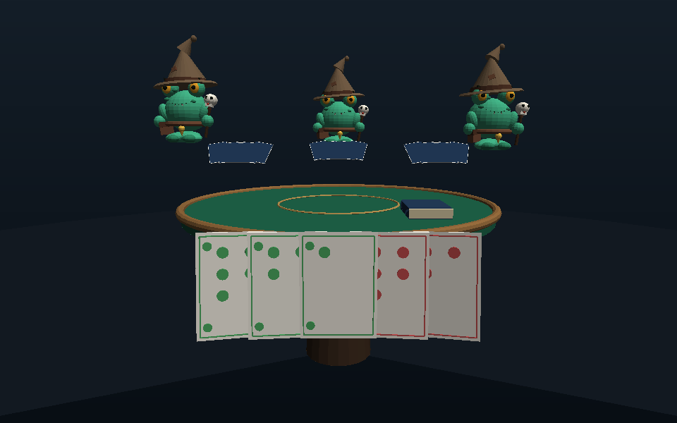
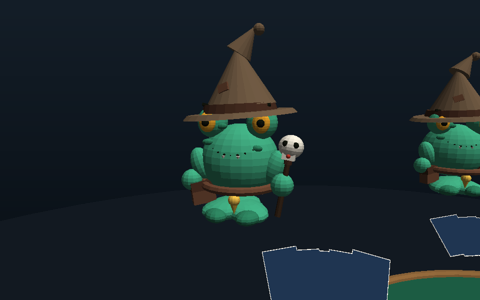
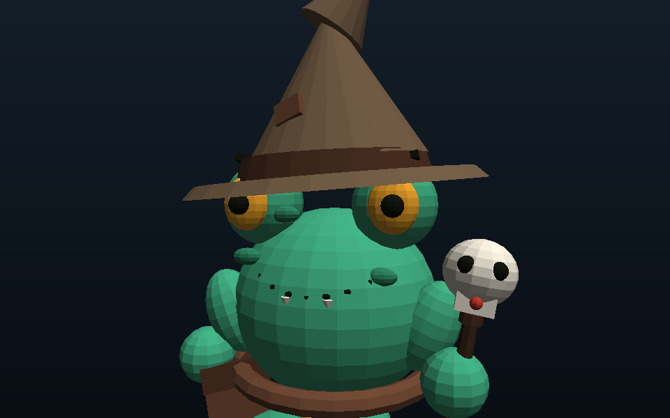

# Kart Brokers — Kurbağa Büyücüler

Tek dosyalık three.js (r128) kart oyunu. Masada **kurbağa büyücü** oyuncular var:
bağdaş kurmuş bacaklarla **havada süzülüyorlar**, yukarı-aşağı **çok çok yavaş**
salınıyorlar ve **kamera da daha da yavaş** hareket ediyor (mide bulantısı yok).



## Çalıştırma

```bash
npm run serve      # python3 -m http.server 8080
# tarayıcı: http://localhost:8080/index.html
```

Dosya doğrudan da açılabilir (`file://.../index.html`), çünkü three.js `vendor/`
içinde gömülü ve hiçbir ağ isteği yok.

## Kontroller

| Tuş / buton | İşlev |
|---|---|
| **Desteden çek** (`boşluk`) | Deste kıvrılır, kart önüne gelir |
| **Al** (`1`) | Çekilen kart eline girer |
| **Ortaya at** (`2`) | Çekilen kart masaya (ortaya) gider |
| **Geri koy** (`3`) | Kart desteye döner, deste düzleşir |
| **Pas** (`p`) | Sırayı devret |
| Elindeki karta tıkla | O kartı ortaya at |
| Ortadaki karta tıkla | Rakibin attığı kartı kap (sıra sendeyken) |
| `h` / `Esc` | Yardım aç / kapat |

Elini ilk bitiren kazanır. Deste biterse/çok pas geçilirse en az kartı olan kazanır.

## Oyuncular (kurbağa büyücü)

`game.js` içindeki `makeFrogWizard()` karakteri sıfırdan ilkel şekillerle kurar:

- **Bağdaş kurmuş bacaklar**: iki yassı elipsoid çapraz (`rotation.y = ±0.62`),
  önde birleşen iki ayak. Yürüme/adım animasyonu yok, bacaklar hiç oynamaz.
- **Gövde**: yeşil, göbek açık yeşil, koyu leke benekleri.
- **Gözler**: büyük, amber iris + siyah bebek + koyu kaş çizgisi.
- **Ağız**: gövde yüzeyine oturan gülümseme noktaları + iki küçük diş.
- **Büyücü şapkası**: geniş kenar, deri bant, kıvrık uç, yama.
- **Deri kuşak + omuz kayışı + yan çanta + sarı tılsım/püskül.**
- **Kurukafa asa**: ahşap sap, kemik kurukafa, kırmızı taş.



### Süzülme ve kamera (mide bulantısı ayarları)

`game.js` başındaki sabitler — hepsi **çok yavaş**:

| Sabit | Değer | Anlamı |
|---|---|---|
| `BOB_AMP` | `0.032` | ±3,2 cm yukarı-aşağı |
| `BOB_PERIOD` | `12.0` s | Bir tam salınım (12 saniyede bir iner-çıkar) |
| `CAM_AMP_X` / `CAM_PERIOD_X` | `0.016` / `17 s` | Kameranın yatay kayması |
| `CAM_AMP_Y` / `CAM_PERIOD_Y` | `0.011` / `28 s` | Kameranın dikey kayması |
| `CAM_LOOK_PERIOD` | `23 s` | Bakış noktasının salınımı |

- Fare paralaksı **yok**, ani kamera hareketi **yok**, sarsıntı **yok**.
- Her oyuncunun fazı farklı (`phase`) ve periyodu biraz farklı olduğu için
  senkron "robot" gibi durmuyorlar.
- Animasyonlar `performance.now()` tabanlı; 30/60/144 FPS'te aynı hızda.



## Testler

```bash
npm test        # sahne testi: deste kıvrımı, ortaya atılan/alınan kart konumları,
                # 2/3/4 kişilik oyunların bitmesi, NaN/uzak konum taraması
npm run test:ui # arayüz duman testi: butonlar, tuşlar, sıra akışı, pointer olayı
```

`test/scene-test.js` gerçek three.js'i yükler, sadece çiziciyi sahte (FakeRenderer)
ile değiştirir; yani oyun kodu gerçekten çalışır.

## Görsel önizleme (tarayıcısız)

`tools/preview.js` küçük bir yazılım rasterizer'ı: sahneyi three.js
geometrilerinden PNG'ye çizer (WebGL/tarayıcı gerekmez).

```bash
node tools/preview.js 4 docs/ekran-masa.png        # masa genel görünüm
node tools/preview.js 4 docs/ekran-karakter.png boy # tek karakter, tam boy
node tools/preview.js 4 docs/ekran-yakin.png yakin  # yüz yakın plan
node tools/preview.js 4 docs/ekran-cekim.png cekim  # kart çekilmiş hâl
```

## Dosyalar

```
index.html          arayüz (HUD, yardım)
game.js             tüm oyun: sahne, karakterler, deste/kart, kurallar, kamera
vendor/three.min.js three.js r128 (MIT, gömülü)
test/scene-test.js  sahne testi
test/ui-test.js     arayüz duman testi
tools/preview.js    tarayıcısız PNG önizleme
```

## Notlar / sınırlar

- Oyun şu an **yerel**: 1 insan + 1-3 bilgisayar oyuncu. Eski sürümdeki
  `KART_BROKERS`/WebSocket çok oyunculu protokolü elimizde olmadığı için
  yeniden yazılmadı; iskelet (`fetch`/`WebSocket` parametreleri) hazır.
- Sahne kartları `cards[]` dizisinde mesh olarak tutulur; el/orta/deste/ıskarta
  yerleşimi `refresh()` içinde tek yerden hesaplanır.
